# GFX-01 — ba hướng ánh sáng, bản nháp để Lead/Duy chọn

2026-11-13T14:56:07.406Z · Microsoft Edge · ANGLE (NVIDIA, NVIDIA GeForce RTX 3060 (0x00002503) Direct3D11 vs_5_0 ps_5_0, D3D11)

Đã chụp **12 ảnh 1600×900**, đo **18 cấu hình** (3 cảnh × A/B/C × High/Low). Không lỗi JavaScript/HTTP trong capture. Dữ liệu gốc: [results.json](results.json). Đây là bàn dựng Vite độc lập, chưa ghép vào world.

## Chạy lại

Từ root repo, chạy hai terminal (PowerShell dùng `pnpm.cmd` nếu `pnpm.ps1` bị chặn):

`pnpm exec vite tools/styleframes --config tools/styleframes/gfx01.vite.config.mjs --configLoader native`

`node tools/styleframes/capture-gfx01.mjs`

Mở `http://127.0.0.1:4190/aaa.html`; chọn cảnh/hướng/chất lượng bằng UI, H ẩn/hiện bảng. Trạng thái chỉ ở memory; không ghi URL/storage/cookie. Có thể dùng `GFX01_BASE_URL`, hoặc `GFX01_CDP_URL` để nối Edge đang mở. Cache riêng nằm trong `tools/styleframes/.verify-dist/` đã được ignore. Capture mới lưu cả ảnh, JSON và README cùng thư mục.

## 9 khung High · 1600×900

| Cảnh | A · R1 nâng cấp | B · Painterly bán thực | C · Gần thực (thử nghiệm) |
|---|---|---|---|
| first-light | 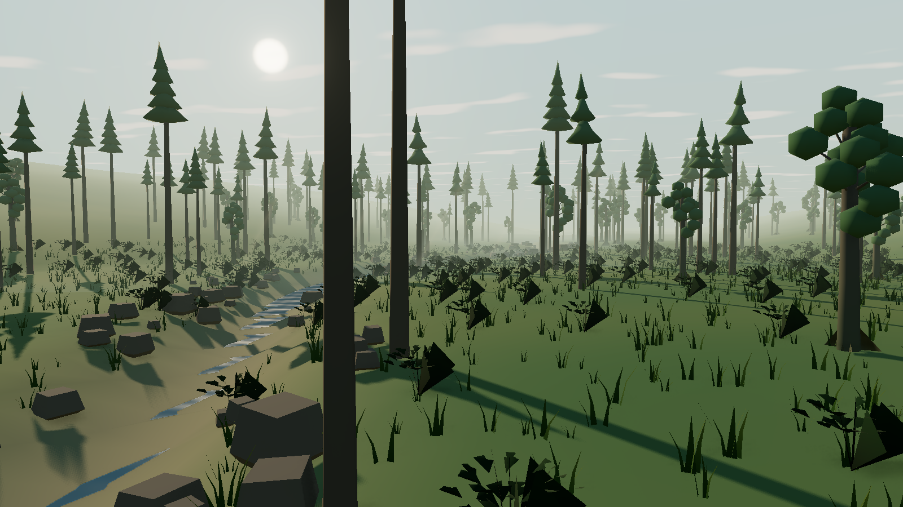 | 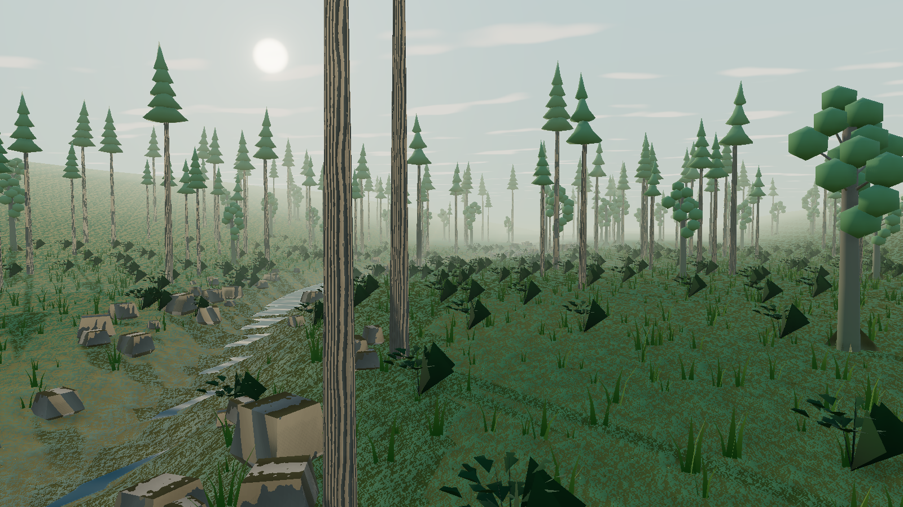 | 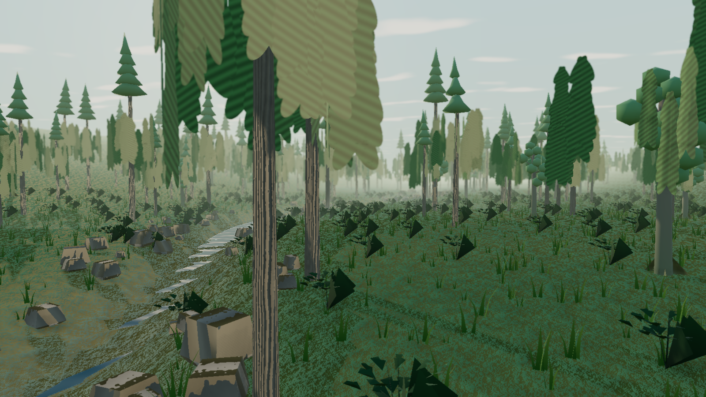 |
| horizon | 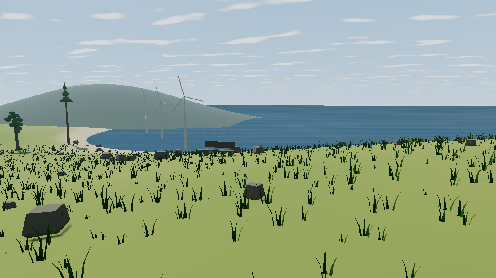 | 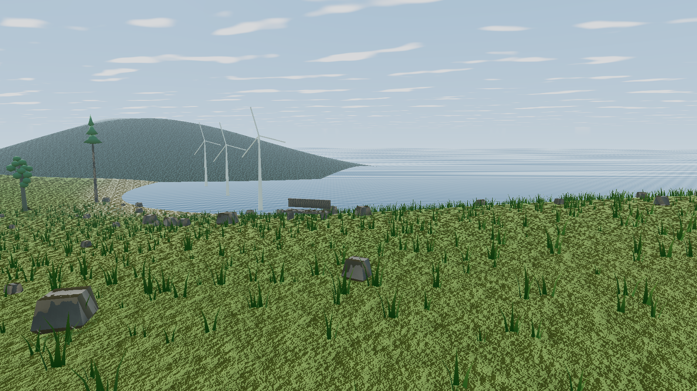 | 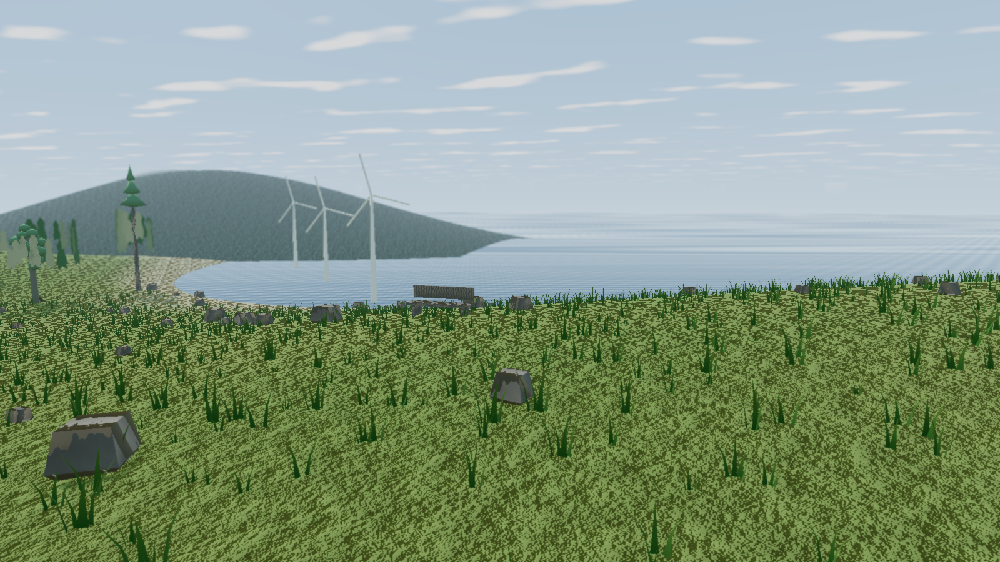 |
| last-postcard | 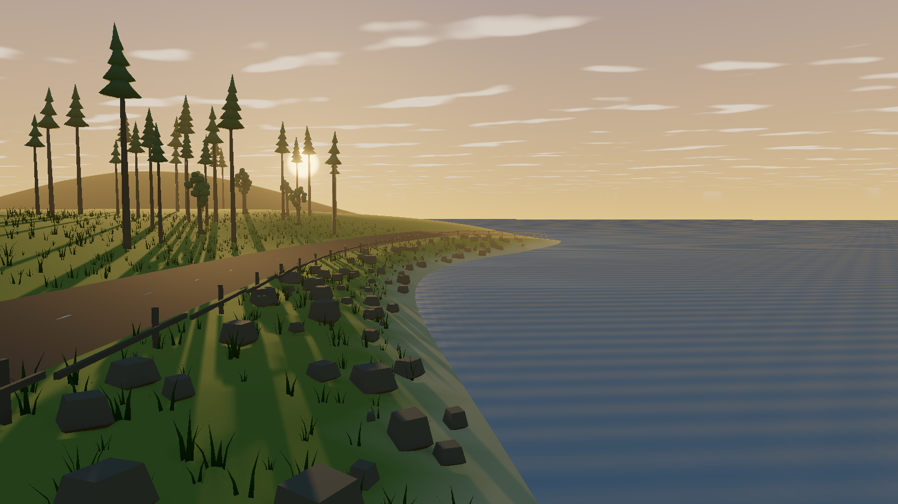 | 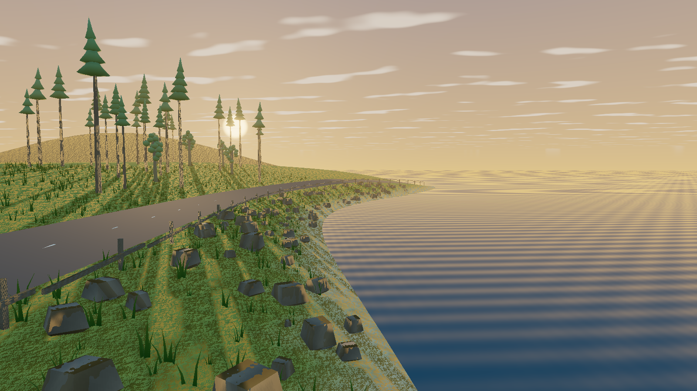 | 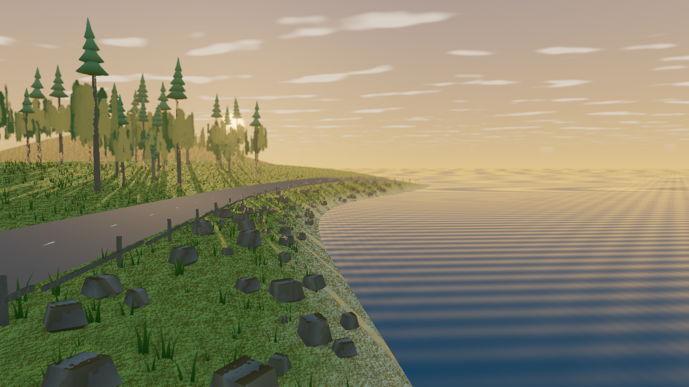 |

## 3 khung Low · 1600×900

Chọn B Low làm mẫu mỗi cảnh; vẫn đo đủ A/B/C Low trong bảng bên dưới. Render nội bộ 1040×585 rồi trình bày ở 1600×900.

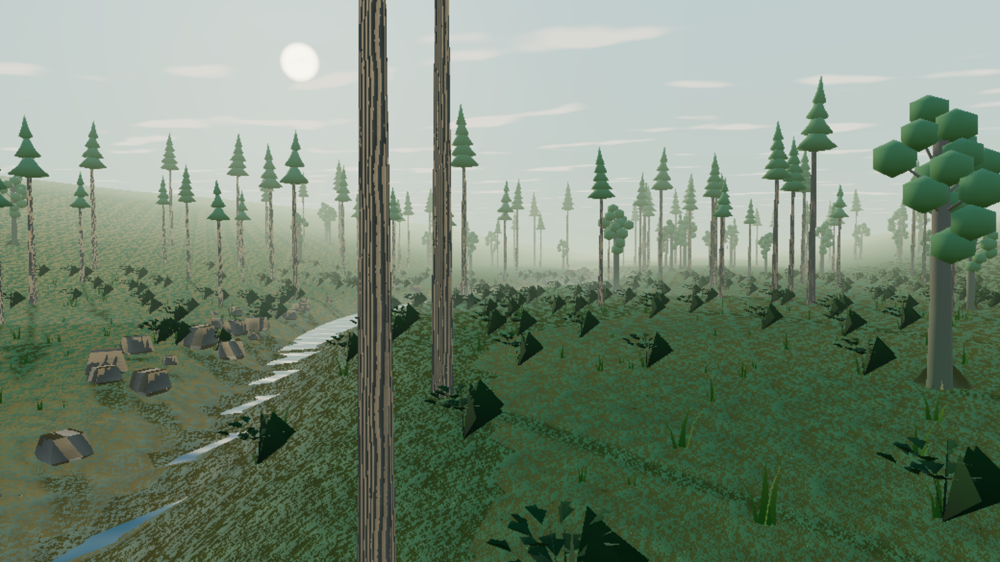

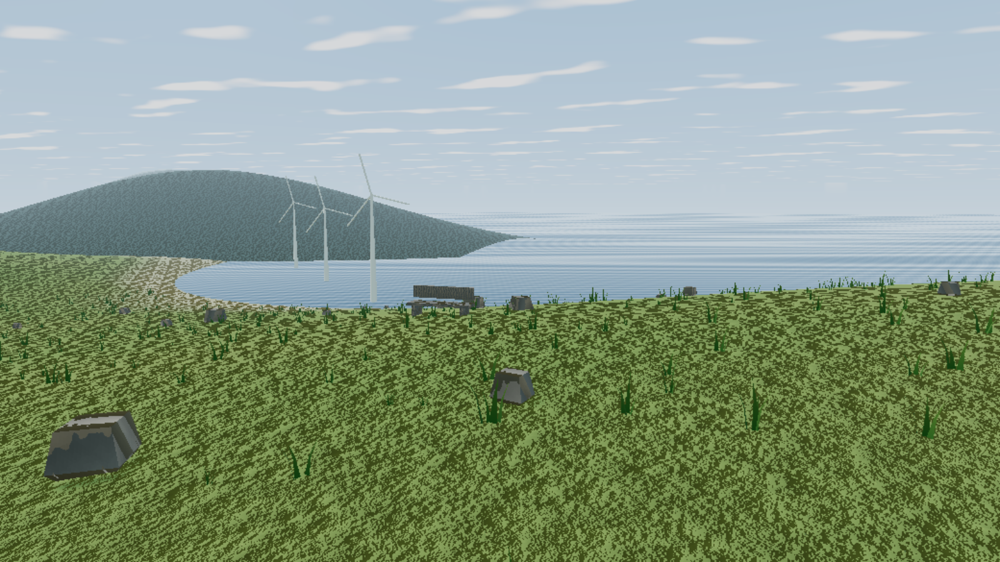

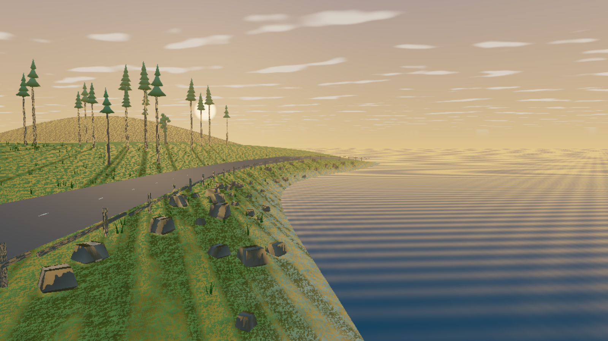

## Chi phí thật trên máy dev

45 warm-up frames, >=120 RAF/CPU samples (rolling window <=240); >=30 non-disjoint GPU samples when supported. Counts include all render, shadow and post passes.

| Cảnh | Hướng | Preset | Pixel nội bộ | Draw calls | Tam giác qua mọi pass | GPU p50 / p95 ms | CPU submit p50 ms | RAF p50 / p95 ms |
|---|---|---|---|---|---|---|---|---|
| first-light | A | High | 1600×900 | 92 | 589298 | 9.69 / 12.96 | 1.00 | 10.00 / 10.10 |
| first-light | B | High | 1600×900 | 92 | 589298 | 9.77 / 12.94 | 1.20 | 10.00 / 10.10 |
| first-light | C | High | 1600×900 | 118 | 877020 | 9.01 / 13.95 | 1.10 | 10.00 / 10.10 |
| horizon | A | High | 1600×900 | 124 | 234506 | 9.88 / 10.86 | 1.30 | 10.00 / 10.10 |
| horizon | B | High | 1600×900 | 124 | 234506 | 9.70 / 11.31 | 1.30 | 10.00 / 10.10 |
| horizon | C | High | 1600×900 | 164 | 350230 | 9.83 / 11.39 | 1.50 | 10.00 / 10.10 |
| last-postcard | A | High | 1600×900 | 301 | 252551 | 9.84 / 10.94 | 1.70 | 10.00 / 10.10 |
| last-postcard | B | High | 1600×900 | 301 | 252551 | 9.83 / 11.67 | 1.90 | 10.00 / 10.10 |
| last-postcard | C | High | 1600×900 | 401 | 375649 | 9.64 / 12.38 | 2.10 | 10.00 / 10.10 |
| first-light | A | Low | 1040×585 | 46 | 216489 | 0.35 / 10.16 | 0.60 | 10.00 / 10.10 |
| first-light | B | Low | 1040×585 | 46 | 216489 | 2.78 / 10.36 | 0.60 | 10.00 / 10.10 |
| first-light | C | Low | 1040×585 | 48 | 221641 | 0.76 / 10.15 | 0.70 | 10.00 / 10.10 |
| horizon | A | Low | 1040×585 | 51 | 71561 | 1.66 / 10.97 | 0.90 | 10.00 / 10.10 |
| horizon | B | Low | 1040×585 | 51 | 71561 | 0.28 / 10.10 | 0.90 | 10.00 / 10.10 |
| horizon | C | Low | 1040×585 | 51 | 71561 | 0.42 / 9.96 | 0.80 | 10.00 / 10.10 |
| last-postcard | A | Low | 1040×585 | 180 | 89643 | 9.62 / 10.30 | 1.30 | 10.00 / 10.10 |
| last-postcard | B | Low | 1040×585 | 180 | 89643 | 9.45 / 11.02 | 1.30 | 10.00 / 10.10 |
| last-postcard | C | Low | 1040×585 | 182 | 90891 | 9.40 / 11.25 | 1.40 | 10.00 / 10.10 |

Draw calls/tam giác lấy từ `renderer.info`, reset một lần trước cả khung, gồm shadow và mọi pass hậu kỳ. GPU dùng `EXT_disjoint_timer_query_webgl2`; loại mẫu disjoint, không suy GPU từ CPU/RAF. N/A nghĩa là không đủ mẫu GPU hợp lệ hoặc extension không có. CPU submit chỉ đo gửi lệnh. RAF chịu vsync/tải máy dùng chung; không dùng RAF để xếp hạng hướng đồ họa. Mỗi cấu hình đo tuần tự trên cùng browser/context, tối thiểu 120 mẫu CPU và 30 mẫu GPU khi hỗ trợ; đây là lượt khảo sát ngắn, chưa phải benchmark T08.

## Byte asset mới mỗi hướng

| Hướng | High (byte) | Low (byte) |
|---|---|---|
| A | 0 | 0 |
| B | 3932704 | 3932704 |
| C | 12687385 | 4062906 |

Đây là tổng byte file thực mỗi cấu hình tải, không cộng decoder/runtime có sẵn, không phải VRAM hay tổng tải toàn trang. B dùng ground/rock/bark albedo ETC1S + normal UASTC KTX2 1K và HDR RGBE 512×256. C High dùng 2K và lá alpha-cutout 2K; C Low dùng 1K. A không cần asset ảnh mới. Manifest kích thước: [asset-bytes.json](../../../tools/styleframes/aaa/asset-bytes.json).

15 asset project-original, tự sinh và dành cho CC0-1.0, mỗi file có dòng trong `assets/LICENSES.csv`. Không tải file ngoài, không dùng pixel tham chiếu hay thương hiệu. Tái sinh bằng `node tools/assets/textures/generate-aaa.mjs` với KTX-Software sẵn trên máy; PNG trung gian ở `tmp/`.

## Cấu hình và giới hạn đã biết

- A High: geometry R1, shadow 2048 PCF lọc mềm (Three r187 dùng PCFShadowMap), GTAO nửa độ phân giải/8 mẫu, bloom 0.13, grading nhẹ, mist billboard và rim light. B thêm PBR/IBL, phản chiếu trời và Fresnel nước. C thêm lá cutout/back scatter xấp xỉ và DOF nhẹ. Sương/lá được bỏ khỏi depth/normal override; AO/DOF dùng tán đặc xấp xỉ.
- Low: 65% mỗi chiều, shadow 1024, giảm cây/cỏ/lá/sương, tắt AO/bloom/DOF; B/C giữ IBL. **Iris Xe chỉ là ước lượng cấu hình**, chưa nghiệm thu 30 FPS/T08. Số RTX 3060 phía trên không thay cho iGPU. Số pixel Low bằng 42,25% High; alpha overdraw của C vẫn cần đo trên máy chuẩn.
- C High cần 12.687.385 byte asset, vượt ngân sách 8 MB đầu vào nếu tải hết ngay; số tam giác qua pass tăng khoảng 49% so với A ở cả ba cảnh. Chỉ dùng để so hướng, cần giảm leaf/pass và tải trì hoãn trước khi xét gate world +25% tam giác. Chưa chứng minh đạt ngân sách sản xuất.
- Đã tự xem ảnh: B/C hiện lộ vân procedural lặp ở mặt đất/vỏ cây; C có leaf card tiền cảnh khá lớn. C vẫn dựa trên tán R1, chưa là cây gần thực hoàn chỉnh. Lead/Duy cần duyệt tỷ lệ lá và độ mạnh normal trước khi port. Three có cảnh báo tham số material undefined dùng giá trị mặc định; capture không có error.
- Cùng bố cục/camera/seed giữa A/B/C mỗi preset; Low giảm mật độ. Không dùng asset GFX-02 và không sửa world. Gate 8 khu/luma ±0,03, world load-budget và CPU so main thuộc bước tích hợp do Lead chạy sau khi chọn hướng.

Danh sách file, output kiểm tra và ví dụ nối vào `index.ts` (≤15 dòng) ở [bàn giao](../../../tools/styleframes/HANDOFF-GFX-01.md).
